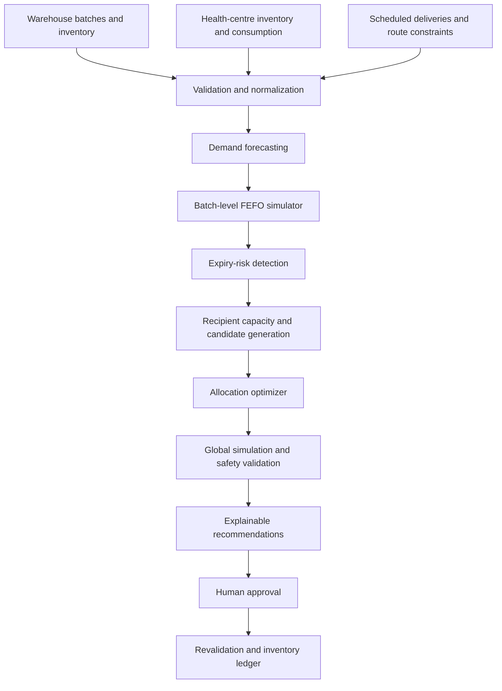

# MedShift Guard

**Demand-aware, expiry-conscious medicine allocation and redistribution decision support**

> **Project status:** Hackathon MVP in development. The architecture, algorithms, and interfaces below describe the intended implementation; they are not claims that all features are already operational.

## Overview

MedShift Guard is a decision-support system designed to reduce avoidable medicine expiry wastage without simply transferring excess stock from one facility to another. It estimates medicine consumption, simulates batch-level inventory using **First Expiry, First Out (FEFO)**, identifies at-risk stock, and recommends feasible quantities and destinations for authorized transfers.

**Core question:** *Which medicine batches should be allocated to which eligible health facilities, in what quantities, and when—if at all?*

The system can recommend **no transfer** when redistribution would be unsafe, ineffective, or unjustified. Human approval is required before dispatch.

## Problem

Near-expiry medicine stock may be distributed without adequate consideration of receiving facilities' consumption patterns, existing inventory, or remaining shelf life. This can move expiry wastage downstream instead of preventing it.

A 2024 Chhattisgarh CAG audit reported **3,528 instances involving 179 drugs, valued at approximately ₹4.87 crore**, of near-expiry medicines being supplied without adequate consideration of consumption patterns, with some medicines expiring at receiving facilities. This is evidence of a documented allocation problem—not proof that all existing inventory systems lack demand-aware capabilities.

**Source:** [CAG, Government of Chhattisgarh, Report No. 2 of 2024](https://cag.gov.in/webroot/uploads/download_audit_report/2024/Report-No.-2-of-2024%2C-Government-of-Chhattisgarh-068b1752fcef9c4.19472333.pdf)

## Proposed Solution

### Phase 1 — Warehouse Guard (hackathon priority)

- Identify batches projected to expire under current distribution plans.
- Estimate demand at receiving health centres using historical consumption and data-quality checks.
- Simulate existing and incoming batches with FEFO consumption.
- Calculate how much additional stock each eligible centre could actually consume before expiry.
- Recommend multi-centre allocations that respect stock, storage, transport, and authorization constraints.
- Compare proposed allocations against a no-intervention or conventional-allocation baseline.
- Present explainable recommendations for human review.

### Phase 2 — Facility Guard (planned extension)

- Detect surplus that arises at health centres after distribution.
- Evaluate authorized health-centre-to-health-centre transfers using the same decision engine.

Potential future extensions include procurement planning and inter-warehouse redistribution. They are **not required** for the initial MVP.

## System Architecture



**Implementation approach:** A modular monolith, with a React frontend, FastAPI backend, SQLite database, and a standalone Python decision engine. The backend handles data access, authorization, approvals, and persistence; the algorithm engine computes recommendations without modifying inventory directly.

## Seven Core Algorithms

| # | Component | Approach | Output |
|---|---|---|---|
| 1 | Demand forecasting | Moving average / adjusted recent consumption | Estimated daily demand per medicine and facility |
| 2 | FEFO inventory simulation | Min-heap / priority queue by expiry | Projected batch consumption, expiry, and shortages |
| 3 | Expiry-risk detection | Baseline simulation | At-risk quantities by batch |
| 4 | Recipient capacity | FEFO simulation + binary search when feasibility is monotonic | Maximum feasible quantity per recipient and batch |
| 5 | Transfer candidate generation | Eligibility filtering | Valid source–destination–batch options |
| 6 | Allocation optimization | Constrained greedy initialization + simulation-guided local search | Proposed transfer quantities |
| 7 | Final validation | Full network simulation and constraint checks | Approved-for-review recommendations or no-transfer outcome |

**Important:** These are seven logical stages, not necessarily seven Python functions. Binary search is appropriate only after verifying that the specific feasibility predicate is monotonic. The MVP's greedy/local-search approach does **not** guarantee a globally optimal solution.

### Processing Workflow

1. **Validate:** Check medicine identity, strength, formulation, units, expiry, quality status, and data completeness.
2. **Forecast:** Estimate expected demand and conservative demand scenarios, accounting for stockout-distorted records where possible.
3. **Simulate:** Process batches by expiry date, scheduled arrivals, and daily consumption.
4. **Detect risk:** Find stock projected to remain unused by expiry under the baseline plan.
5. **Calculate capacity:** Test how much of an incoming batch a recipient can consume without causing unacceptable downstream effects.
6. **Optimize:** Allocate across eligible facilities while preserving donor reserves and respecting logistical constraints.
7. **Revalidate:** Simulate all proposed transfers together; explain outcomes and request approval.

### Safety and Operational Constraints

- Exact medicine identity, strength, dosage form, and unit compatibility.
- Quality release, recall/quarantine status, and suitable storage conditions.
- Authorization for each proposed movement.
- Feasible transport arrival before the usable planning deadline.
- Donor safety stock and existing commitments.
- Recipient consumption capacity, existing batches, and scheduled deliveries.
- No double allocation of warehouse stock or double counting of recipient demand.
- Pack-size, route, and handling constraints where applicable.

**Safety constraints are hard constraints**, not trade-offs against projected savings. An optimization result is a proposal; stock movement requires authorized approval, revalidation, dispatch, and receipt confirmation.

## Example: One Batch, Three Centres

A warehouse holds **500 tablets of batch B101**, with **10 usable planning days** remaining.

| Centre | Estimated daily consumption | Existing stock | Potential B101 consumption in 10 days |
|---|---:|---:|---:|
| A | 30 | 100 | 300 |
| B | 10 | 50 | 100 |
| C | 15 | 200 | 150 |

For this **synthetic illustration**, assume all existing stock expires later than B101, no other deliveries are expected, transport is feasible, and all recipients are authorized. Because B101 would be consumed first under FEFO, the centres may be able to accept B101 even when they already have inventory.

A feasible example allocation is:

- **A:** 300 tablets
- **B:** 100 tablets
- **C:** 100 tablets
- **Total:** 500 tablets

If all 500 were instead sent to B, B's ten-day consumption capacity would be only 100 tablets, leaving **400 incoming tablets projected unused**. In the example allocation, all 500 incoming tablets are projected to be consumed.

**These are hypothetical calculations, not verified savings.** A real decision must also check the expiry of displaced existing stock, demand uncertainty, shipment costs, and the complete network inventory simulation.

## Suggested Tech Stack

| Layer | Technology |
|---|---|
| Frontend | React + Tailwind CSS |
| Backend | Python + FastAPI |
| Database | SQLite (MVP) |
| Decision engine | Python (`heapq`, standard collections) |
| Optimization extension | Google OR-Tools (optional) |
| Tests | pytest |
| Version control | Git + GitHub |

## Suggested Repository Structure

```text
medshift-guard/
├── frontend/                  # React dashboard
├── backend/
│   ├── main.py                # FastAPI entry point
│   ├── api/                   # Inventory, analysis, transfers
│   ├── engine/
│   │   ├── validation.py
│   │   ├── forecasting.py
│   │   ├── simulation.py
│   │   ├── risk_detection.py
│   │   ├── capacity.py
│   │   ├── candidates.py
│   │   ├── optimizer.py
│   │   └── explanation.py
│   ├── models/
│   ├── database/
│   └── tests/
├── sample_data/               # Clearly labeled synthetic inputs
├── requirements.txt           # To be finalized during implementation
└── README.md
```

## Integration Contract

The decision engine should expose one stable entry point, for example:

```python
from engine.optimizer import optimize_allocation

result = optimize_allocation(
    inventory=inventory_data,
    facilities=facility_data,
    demand=demand_data,
    routes=route_data,
)
```

The engine receives validated data and returns **structured recommendations and explanations**. It does not write to the database or dispatch stock.

**Example response shape (proposed, subject to team agreement):**

```json
{
  "status": "recommendations_available",
  "recommendations": [
    {
      "batch_id": "B101",
      "source_id": "W1",
      "destination_id": "A",
      "quantity_units": 300,
      "reason": "Projected consumable before the planning deadline",
      "requires_approval": true
    }
  ],
  "warnings": [],
  "baseline_metrics": {},
  "proposed_metrics": {}
}
```

### Proposed API Endpoints

| Endpoint | Purpose |
|---|---|
| `GET /api/inventory` | Retrieve inventory and batches |
| `GET /api/facilities` | Retrieve facilities |
| `POST /api/analysis/run` | Run the decision engine |
| `GET /api/analysis/{id}` | Retrieve analysis and recommendations |
| `POST /api/transfers/{id}/approve` | Record authorized approval |
| `POST /api/transfers/{id}/reject` | Reject a recommendation |
| `POST /api/transfers/{id}/dispatch` | Revalidate and record dispatch |
| `POST /api/transfers/{id}/receive` | Confirm receipt and update inventory |

**Integration rule:** Agree on data fields, units, date format, function signatures, and response structure before parallel development. Backend and frontend teammates should integrate against a mock engine response early rather than waiting until the last hour.

## Team Responsibilities

| Role | Responsibility |
|---|---|
| Algorithm & Architecture | Forecasting, FEFO, capacity, optimization, tests, engine interface |
| Backend & Database | Models, APIs, inventory ledger, approval workflow, integration |
| Frontend & UX | Dashboard, risk visualization, recommendations, review screens |
| Research & Validation | Evidence, synthetic scenarios, baseline comparisons, adversarial tests, demo |

## Testing and Evaluation

Compare **no intervention**, **naive near-expiry transfer**, and **MedShift Guard** using the same clearly labeled synthetic dataset.

Track:

- Projected expired units and value.
- Projected unmet demand.
- Valid versus invalid transfer proposals.
- Transport and handling costs where available.
- Algorithm runtime.
- Whether any proposal shifts expiry risk to existing recipient stock.

### Essential Edge Cases

- Recipient demand is low or uncertain.
- Recipient has batches expiring earlier than the proposed transfer.
- Multiple incoming batches compete for the same demand.
- Stock expires before the shipment arrives.
- Storage or authorization requirements are not satisfied.
- Donor safety stock would be violated.
- No recipient can safely consume the batch.
- Two approvals attempt to reserve the same stock.

## Getting Started

**The repository is still being built.** Exact installation and run commands will be added after the team commits its initial code and dependency files. Do not assume the suggested folders and APIs already exist.

Recommended development sequence:

1. Agree on the data schema and input/output contracts.
2. Create a small, reproducible synthetic dataset.
3. Implement and test forecasting and FEFO simulation.
4. Add risk detection, recipient capacity, and candidate filtering.
5. Add allocation and global revalidation.
6. Connect the engine to FastAPI and the React dashboard.
7. Run baseline comparisons and rehearse the end-to-end demo.

## Limitations

- Forecasts are uncertain and depend on data quality.
- The MVP's heuristic optimizer is not guaranteed to find the global optimum.
- Real redistribution requires appropriate legal, quality, storage, procurement, and organizational approvals.
- Projected expiry reductions are not the same as observed real-world savings.
- Existing government inventory platforms may already implement parts of this workflow; MedShift Guard's incremental value must be evaluated rather than assumed.

## Project Goal

**Don't just detect near-expiry medicines. Determine whether an eligible facility can actually use them before expiry—and recommend no transfer when it cannot.**

---

*Built as a hackathon prototype. Not intended for unsupervised clinical, pharmacy, or government supply-chain deployment.*
